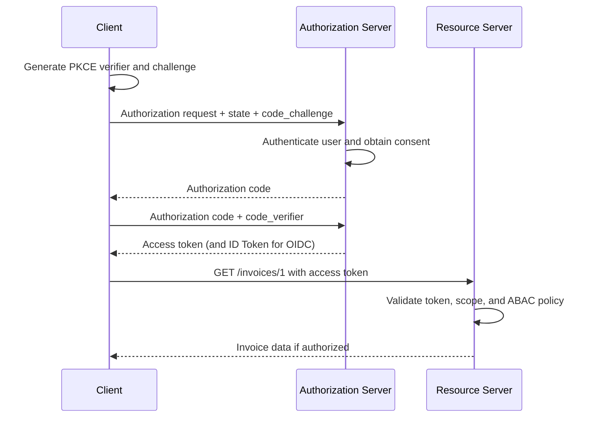

# Laboratory Work No. 11

## OAuth 2.1 and OIDC Flow Diagram

**Figure 1 - OAuth 2.1 Authorization Code Flow with PKCE**

### Explanation

The client starts authorization using PKCE.
The authorization server authenticates the user and issues tokens.
The client presents the access token to the resource server.
The resource server validates the token and checks authorization before returning protected data.